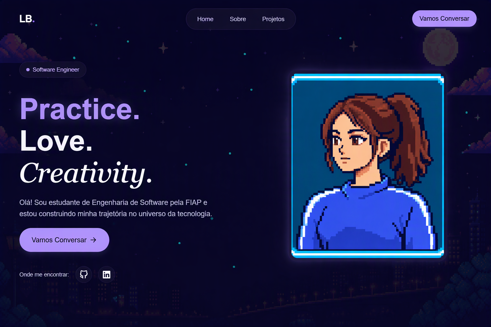

# Portfólio Pessoal

Portfólio pessoal desenvolvido com **React.js**, **Tailwind CSS** e **EmailJS**, inicialmente criado como projeto acadêmico para a disciplina de Web Development da FIAP e posteriormente aprimorado e finalizado de forma independente.

O projeto tem como objetivo apresentar minha trajetória, habilidades, experiências e projetos por meio de uma interface moderna, intuitiva e responsiva.




## Tecnologias utilizadas

- **React.js:** Desenvolvimento da interface utilizando componentes reutilizáveis.
- **Tailwind CSS:** Estilização e criação de layouts responsivos.
- **JavaScript:** Lógica e interatividade da aplicação.
- **HTML5:** Estruturação do conteúdo.
- **EmailJS:** Integração para envio de mensagens diretamente pelo formulário de contato, sem necessidade de um backend próprio.

## Funcionalidades

- Layout responsivo, adaptado para diferentes tamanhos de tela.
- Seção de apresentação pessoal.
- Apresentação de habilidades e tecnologias.
- Exibição de projetos desenvolvidos.
- Informações de contato e redes sociais.
- Formulário de contato integrado ao EmailJS.

## Como executar o projeto

### 1. Clone o repositório

```bash
git clone https://github.com/LauraBarret0/portfolio-react.git
```

### 2. Acesse a pasta do projeto

```bash
cd portfolio-react
```

### 3. Instale as dependências

```bash
npm install
```

### 4. Execute o projeto

```bash
npm run dev
```

O projeto estará disponível no endereço local informado pelo Vite, geralmente `http://localhost:5173`.

## Contexto do projeto

O projeto foi iniciado como parte da entrega do **Checkpoint 2 – Web Development**, da FIAP. Posteriormente, retomei seu desenvolvimento, realizando melhorias e finalizando a aplicação por iniciativa própria, como parte do meu processo de aprendizado e evolução em desenvolvimento web.

